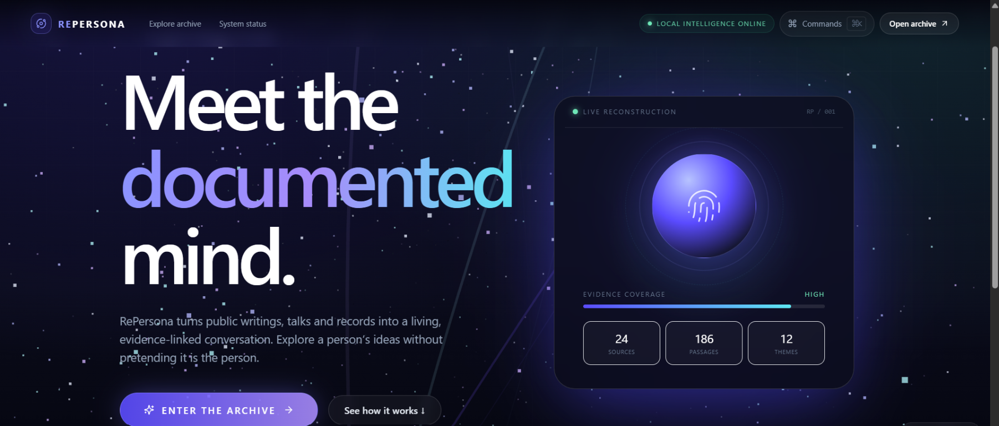
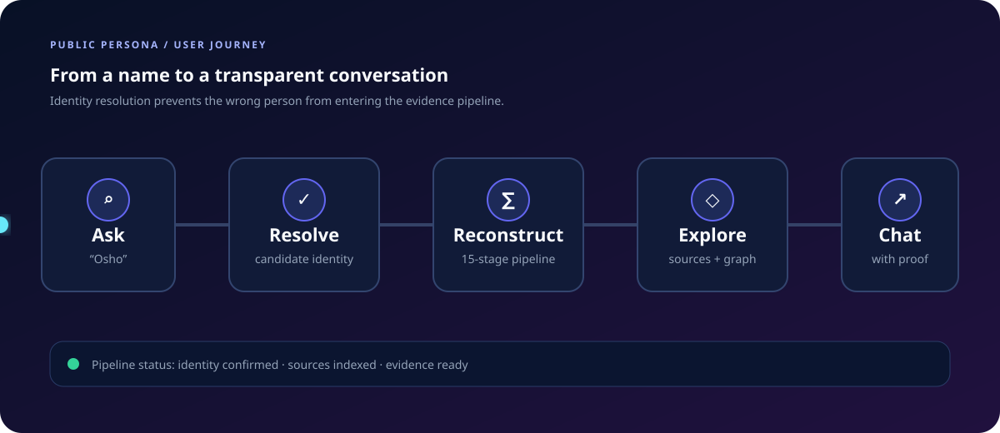
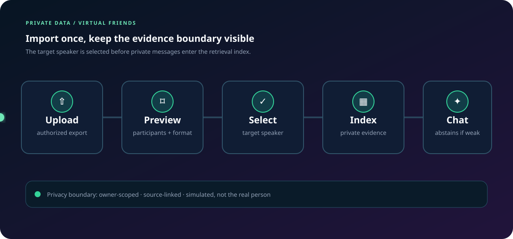

# RePersona

**Explore the documented mind of history.** RePersona is an AI-powered research and conversation app that builds evidence-grounded simulations of public and historical figures from accessible source material. It can also create private, evidence-grounded Virtual Friends from authorized conversation exports.

> RePersona creates clearly labeled AI simulations. It does not recreate a person's consciousness, represent their actual identity, or claim to communicate with them.

<p align="center">
  
</p>

<p align="center">
  
</p>

_The animation above shows the live product flow: discover sources, analyze them, retrieve evidence, and return a guarded answer._

### Working flows

<p align="center">
  
</p>

_Public persona journey: enter a name, resolve the identity, run the reconstruction pipeline, explore the profile, and open a source-backed chat._

<p align="center">
  
</p>

_Virtual Friend journey: upload an authorized export, preview participants, choose the target speaker, index private evidence, and chat with abstention when coverage is weak._

## Product overview

RePersona combines source discovery, multimodal ingestion, retrieval-augmented generation, temporal guardrails, and transparent evidence display in one local-first application.

### Historical and public personas

- Resolve ambiguous names into candidate identities before building a profile.
- Collect public biographies, article text, documented quotations, and portraits from Wikipedia, Wikiquote, Wikimedia, and optional authorized providers.
- Build a profile, timeline, knowledge graph, source collection, insights, and estimated knowledge coverage.
- Stream progress through a 15-stage persona-building pipeline using Server-Sent Events.
- Ask questions in Evidence, Persona Simulation, Historical, or Current Context + Persona modes.
- Show supporting sources, relevance, temporal context, knowledge cutoffs, provider status, and reasoning information alongside answers.
- Add pasted text or upload documents and media. OCR, PDF extraction, and audio/video transcription are optional capabilities.

### Reality and temporal guardrails

The backend classifies questions as historical, present-day, or hypothetical. Questions about current events or facts after a deceased person's documented lifespan are routed to the current-context path and require fresh results from a configured search provider. If no provider is available, the app reports that current-context data is unavailable instead of inventing facts.

### Accounts and private Virtual Friends

- Register, sign in, inspect the current account, and sign out through bearer-token authentication.
- Keep user-created personas, uploads, conversations, staged imports, and Virtual Friends owner-scoped.
- Create a Virtual Friend from an authorized WhatsApp, Instagram, Telegram, Facebook Messenger, TXT, JSON, or CSV export.
- Preview detected participants before selecting the target speaker and confirming the import.
- Normalize messages, preserve conversation context, index private chunks, and extract documented/observed/inferred memories.
- Chat using only the selected friend's uploaded evidence; the system abstains when the evidence is insufficient.
- Inspect, reprocess, or delete transcripts, memories, and chat sessions.

Virtual Friends are simulations of communication style based on uploaded messages. They are not the real person and do not claim that person's identity, consciousness, memories, or current knowledge. Use only data you are authorized to process.

## Architecture

The Next.js frontend calls the FastAPI backend through JSON REST endpoints and Server-Sent Events. The backend discovers or accepts sources, extracts and chunks text, analyzes the material, indexes it for retrieval, and generates answers with evidence. SQLite and lightweight offline components are suitable for local development; PostgreSQL, Ollama, hosted LLMs, neural embeddings, FAISS, and external discovery providers are optional.

```text
Browser / Next.js UI
        │ REST + SSE
        ▼
FastAPI API ── authentication, personas, imports, chat, providers
        │
        ├── SQLAlchemy + SQLite/PostgreSQL
        ├── source discovery and multimodal ingestion
        ├── embeddings + FAISS/in-memory retrieval
        └── LLM/current-context providers with evidence guardrails
```

## Requirements

- Python 3.11 or later
- Node.js 18 or later with npm
- Docker Desktop / Docker Engine and Compose, only if using Docker
- Optional: [Ollama](https://ollama.com) for local LLM responses
- Optional: Tesseract OCR and FFmpeg for scanned images and audio/video processing

## Quick start

### Windows one-click setup

Double-click [`START_REPERSONA.bat`](./START_REPERSONA.bat) from the project root. On first launch it creates the backend environment, installs dependencies, copies local environment files, starts the backend and frontend, and opens <http://localhost:3000>.

### Manual setup

Start the backend in one terminal:

```powershell
cd backend
python -m venv .venv
.venv\Scripts\Activate.ps1
pip install -r requirements.txt
Copy-Item .env.example .env
uvicorn app.main:app --reload
```

Start the frontend in another terminal:

```powershell
cd frontend
npm install
Copy-Item .env.example .env.local
npm run dev
```

Open <http://localhost:3000>. The API is available at <http://localhost:8000> and interactive API documentation is available at <http://localhost:8000/docs>. SQLite is the default database. With `DEMO_MODE=true`, startup seeds a ready Osho demonstration persona.

For authenticated use, set a random `AUTH_SECRET` in `backend/.env`, then register at <http://localhost:3000/auth>. Passwords must be at least 12 characters. Persona management, uploads, conversations, and all Virtual Friends endpoints require authentication.

### Docker Compose

Set `AUTH_SECRET` in the shell before starting the production-style Compose stack:

```powershell
$env:AUTH_SECRET = "replace-with-a-long-random-secret"
docker compose up --build
```

Compose starts PostgreSQL, the API, and the frontend. Visit <http://localhost:3000>. Stop services with `docker compose down`. PostgreSQL data remains in the named `pgdata` volume; `docker compose down -v` also removes that data.

## Configuration

Copy [`backend/.env.example`](./backend/.env.example) to `backend/.env`. Keep secrets in local environment files and never commit API keys.

| Setting | Default | Description |
|---|---|---|
| `SOURCE_MODE` | `auto` | `auto`/`wikipedia` uses public Wikipedia, Wikiquote, and Wikimedia APIs; `demo` uses the bundled offline corpus. |
| `WIKIPEDIA_LANG` | `en` | Wikimedia language edition. |
| `DEMO_MODE` | `true` | Seeds the ready Osho demo persona at startup. |
| `DATABASE_URL` | SQLite | SQLAlchemy URL; PostgreSQL is supported. |
| `LLM_PROVIDER` | `auto` | `auto`, `demo`, `ollama`, or `openai_compatible`. Auto uses reachable Ollama or the offline composer. |
| `LLM_BASE_URL` | `http://127.0.0.1:11434` | Ollama or compatible service URL. |
| `LLM_MODEL` | `llama3.2:3b` | Model name sent to the configured provider. |
| `LLM_API_KEY` | empty | Optional key for a hosted compatible provider. |
| `EMBEDDING_MODEL` | `paraphrase-multilingual-MiniLM-L12-v2` | Neural embedding model; lexical fallback is used when unavailable. |
| `VECTOR_DB` | `faiss` | `faiss` or `memory`; the app falls back to memory when needed. |
| `VECTOR_DIR` | `./data/vector` | Persistent vector index directory. |
| `SEARCH_PROVIDER` / `SEARCH_API_KEY` | empty | Optional `tavily` or `serpapi` current-context/source discovery. |
| `YOUTUBE_API_KEY` | empty | Optional YouTube interview discovery. |
| `NEWS_API_KEY` | empty | Optional current-context news enrichment. |
| `CORS_ORIGINS` | `http://localhost:3000` | Comma-separated allowed frontend origins. |
| `AUTH_SECRET` | development placeholder | Long random signing secret; mandatory for production. |
| `AUTH_TOKEN_TTL_SECONDS` | `86400` | Bearer-token lifetime. |

The frontend setting `NEXT_PUBLIC_API_BASE` belongs in `frontend/.env.local` and defaults to `http://localhost:8000`.

## API surface

The API is mounted under `/api`:

| Area | Main endpoints |
|---|---|
| Health | `GET /api/health` |
| Authentication | `POST /api/auth/register`, `/login`, `/logout`; `GET /api/auth/me` |
| Personas | `POST /api/personas/resolve`, `/create`; `GET /api/personas`; persona detail, sources, topics, insights, timeline, coverage, and knowledge graph routes |
| Sources | `POST /api/personas/{id}/sources/text` and `/sources/upload` |
| Jobs | `GET /api/jobs/{id}` and `/stream` |
| Historical chat | `POST /api/chat` |
| Conversations | `GET/PATCH/DELETE /api/conversations...` |
| Providers | `GET /api/providers` |
| Virtual Friends | `/api/virtual-friends` for creation, staged imports, transcripts, chat, memories, and conversations |

See the interactive OpenAPI documentation at <http://localhost:8000/docs> for request and response schemas.

## Optional capabilities

The base backend requirements are intentionally lightweight. Optional packages can be enabled in [`backend/requirements.txt`](./backend/requirements.txt):

- `sentence-transformers`, `faiss-cpu`, and `numpy` for neural embeddings and FAISS indexing.
- `faster-whisper` or `openai-whisper` plus FFmpeg for audio/video transcription.
- `pytesseract`, Pillow, and the Tesseract system package for OCR.
- `pypdf` for PDF extraction.
- `boto3` for S3-compatible storage.

If optional packages are unavailable, supported paths use lighter offline fallbacks where possible. The first startup with neural embeddings may download the configured model and can take longer than later starts.

## Development and validation

```bash
# Backend tests
cd backend
pytest

# Frontend lint and production build
cd ../frontend
npm run lint
npm run build
npm run start
```

The backend test suite covers authentication, API behavior, discovery, ingestion, temporal classification, RAG, vector persistence, uploads, the demo pipeline, and Virtual Friends.

## Security, privacy, and source limitations

- Passwords are stored as salted PBKDF2-HMAC-SHA256 hashes; tokens are signed and revoked on logout by incrementing the user's token version.
- Private resources carry ownership information and are filtered by the authenticated user.
- Raw Virtual Friend transcript text is retained only to support explicit reprocessing and is deleted with the transcript/friend.
- Source ownership is tracked by source ID, so deleting one import does not remove another import with the same filename.
- Do not upload conversation data without authorization. Use production TLS, a strong `AUTH_SECRET`, restricted CORS origins, and a managed database for deployment.
- RePersona does not bypass paywalls, authentication, robots restrictions, or platform protections. Review source context and licensing before reusing material.
- Generated responses are simulations based on available evidence, not statements made by the historical person or real private contact.

Profiles and coverage estimates can be incomplete or inaccurate, especially when source material is sparse. The bundled demo corpus is synthetic paraphrased material and should not be treated as scholarship or an authentic transcript.

## Project structure

```text
.
├── backend/
│   ├── app/                  FastAPI routers, schemas, models, and services
│   ├── alembic/              Database migrations
│   └── tests/                Backend test suite and fixtures
├── frontend/
│   └── src/app/              Next.js pages and route segments
│       ├── auth/             Registration and login
│       ├── explore/          Persona archive
│       ├── persona/          Build, profile, sources, chat, insights, knowledge
│       └── virtual-friends/  Private import, memory, and chat workflow
├── docs/                     Authentication, Virtual Friends, and visual reports
├── docker-compose.yml        PostgreSQL + API + frontend stack
├── ARCHITECTURE.md           System design and implementation notes
├── SETUP.md                  Extended configuration and troubleshooting
└── START_REPERSONA.bat      Windows one-click launcher
```

## Documentation

- [Setup and troubleshooting](./SETUP.md)
- [Architecture and API design](./ARCHITECTURE.md)
- [Authentication](./docs/AUTHENTICATION.md)
- [Virtual Friends](./docs/VIRTUAL_FRIENDS.md)
- [Backend configuration reference](./backend/.env.example)
- [Frontend configuration example](./frontend/.env.example)

## Contributors

- Raushan / Anurohan

## Contributing

Contributions, issues, and pull requests are welcome. Please keep evidence provenance, privacy boundaries, ethical labels, and test coverage intact when changing the application.
