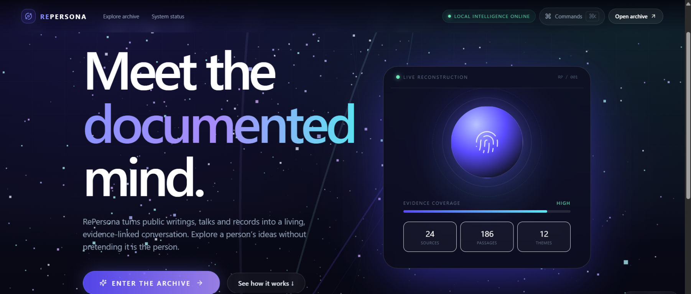

# RePersona

**Explore the documented mind of history.** RePersona is an AI-powered research and conversation app that builds evidence-grounded simulations of public and historical figures from accessible source material. Search for a person, review the sources used to build their profile, and ask questions with answers linked to supporting evidence.

> RePersona creates a clearly labeled AI simulation. It does not recreate a person's consciousness, represent their actual identity, or claim to communicate with them.

<p align="center">
  
</p>

## What it does

- Resolves ambiguous names into candidate identities before building a profile.
- Collects public biographical material, article text, documented quotations, and portraits from Wikipedia, Wikiquote, and Wikimedia APIs.
- Builds a profile, documented timeline, knowledge graph, source collection, and estimated knowledge coverage.
- Streams build progress through a 15-stage pipeline.
- Supports Evidence, Persona Simulation, Historical, and Current Context + Persona answer modes.
- Detects when a question requires present-day knowledge and routes it to live web search rather than the historical corpus.
- Applies temporal guardrails with knowledge cutoffs so the app does not claim a deceased person could have known a later event.
- Shows evidence, source details, temporal context, and reasoning information alongside responses.
- Labels simulated responses separately from verified historical quotations and guards against attributing later events to deceased people.
- Supports adding text and uploading documents or media for ingestion; OCR, PDF extraction, and audio/video transcription require optional dependencies.
- Includes a bundled synthetic demo corpus so the main experience can run without external AI services or API keys.

## How it works

The Next.js frontend calls a FastAPI backend over JSON REST endpoints and Server-Sent Events. The backend discovers or accepts sources, extracts and chunks text, analyzes the material, indexes it for retrieval, and generates answers with source evidence. SQLite and lightweight offline components are suitable for local development; PostgreSQL, hosted or local LLMs, neural embeddings, and external discovery providers are optional.

### Reality guardrails and current-context retrieval

The current build adds a temporal-safety layer that classifies whether a question is historical, present-day, or a hypothetical projection. If a question references events after a person's known lifespan or asks for "what is happening now," the system switches to a Current Context + Persona mode and requires fresh external facts from a configured live search provider. If no provider is configured, RePersona clearly reports that current-context data is unavailable instead of inventing facts.

This boundary is enforced in the backend services responsible for temporal analysis and current-context retrieval, and it is surfaced in the UI as source-aware answer labels, knowledge cutoff metadata, and provider status information.

## Requirements

- Python 3.11 or later
- Node.js 18 or later with npm
- Docker Desktop / Docker Engine and Compose, only if using Docker
- Optional: [Ollama](https://ollama.com) for local LLM responses
- Optional: Tesseract OCR and FFmpeg for scanned images and audio/video processing

## Quick start

### Windows one-click setup

Double-click `START_REPERSONA.bat` from the project root. On first launch, it prepares the backend environment, installs dependencies, sets up local environment files, starts the backend and frontend, and opens the app at <http://localhost:3000>.

### Run manually

Start the backend in one terminal:

```bash
cd backend
python -m venv .venv
# Windows PowerShell: .venv\Scripts\Activate.ps1
# macOS/Linux: source .venv/bin/activate
pip install -r requirements.txt
# Copy .env.example to .env (PowerShell: Copy-Item .env.example .env)
uvicorn app.main:app --reload
```

The API is available at <http://localhost:8000>; interactive API documentation is at <http://localhost:8000/docs>. SQLite is the default database. The backend seeds a ready Osho demo persona when `DEMO_MODE=true`.

Start the frontend in another terminal:

```bash
cd frontend
npm install
# Copy .env.example to .env.local (PowerShell: Copy-Item .env.example .env.local)
npm run dev
```

Open <http://localhost:3000>. The frontend expects the API at `http://localhost:8000` by default. To change it, set `NEXT_PUBLIC_API_BASE` in `frontend/.env.local` and restart the frontend.

### Docker Compose

From the project root:

```bash
docker compose up --build
```

Compose starts PostgreSQL, the API, and the frontend. Visit <http://localhost:3000>. Stop the services with `docker compose down`; PostgreSQL data is kept in the named `pgdata` volume. To remove that volume and its data, use `docker compose down -v`.

## Configuration

Copy `backend/.env.example` to `backend/.env` and adjust as needed. Keep secrets in local environment files; do not commit API keys.

| Setting | Default | Description |
|---|---|---|
| `SOURCE_MODE` | `auto` | `auto` / `wikipedia` uses public Wikipedia, Wikiquote, and Wikimedia APIs; `demo` uses the bundled offline corpus. |
| `WIKIPEDIA_LANG` | `en` | Language edition used for supported Wikimedia sources. |
| `DEMO_MODE` | `true` | Seeds the demonstration persona at startup. |
| `DATABASE_URL` | SQLite | SQLAlchemy connection URL; PostgreSQL is supported. |
| `LLM_PROVIDER` | `auto` | `auto`, `demo`, `ollama`, or `openai_compatible`. Auto uses reachable Ollama or falls back to the offline composer. |
| `LLM_BASE_URL` | `http://127.0.0.1:11434` | Ollama or compatible service URL. |
| `LLM_MODEL` | `llama3.2:3b` | Model name sent to the configured LLM provider. |
| `LLM_API_KEY` | empty | Optional key for a hosted compatible provider. |
| `VECTOR_DB` | `faiss` | Vector store choice; the app can fall back to in-memory storage. |
| `SEARCH_PROVIDER` / `SEARCH_API_KEY` | empty | Optional Tavily or SerpAPI source discovery. |
| `YOUTUBE_API_KEY` | empty | Optional YouTube Data API discovery. |
| `NEWS_API_KEY` | empty | Optional current-context enrichment. |
| `CORS_ORIGINS` | `http://localhost:3000` | Comma-separated frontend origins allowed by the API. |

The frontend setting `NEXT_PUBLIC_API_BASE` belongs in `frontend/.env.local`. More configuration and troubleshooting guidance is in [SETUP.md](./SETUP.md). Provider keys are optional; missing providers are skipped and reported as unconfigured.

### Optional capabilities

The base backend requirements are intentionally lightweight. Optional integrations may require uncommenting/installing packages listed in `backend/requirements.txt`:

- `sentence-transformers`, `faiss-cpu`, and `numpy` for neural embeddings and FAISS indexing.
- `faster-whisper` or `openai-whisper` plus FFmpeg for audio/video transcription.
- `pytesseract`, Pillow, and the Tesseract system package for OCR.
- `pypdf` for PDF text extraction.
- `boto3` for S3-compatible storage.

When optional packages are unavailable, some ingestion paths are unavailable and the app uses lighter offline retrieval components where supported.

## Development commands

```bash
# Backend tests
cd backend
pytest

# Frontend lint and production build
cd ../frontend
npm run lint
npm run build
npm run start
```

## Ethical use and source limitations

RePersona is for research and exploration. Its generated responses are simulations based on available evidence, not statements made by the historical person. The bundled demo corpus is synthetic paraphrased material, not authentic transcripts. The system distinguishes sourced claims, observations, inferences, and unknowns and is designed to avoid fabricating quotations. Source discovery is limited to public APIs and authorized or user-provided material; it does not bypass paywalls, authentication, robots restrictions, or platform protections. Always review source context and licensing before reusing material.

Profiles and coverage estimates can be incomplete or inaccurate, especially when source material is sparse. The demo corpus illustrates the workflow and should not be treated as scholarship.

## Project structure

```text
.
├── backend/               FastAPI API, services, pipeline, database, tests
│   ├── app/                Routers, schemas, models, and AI/source services
│   ├── alembic/            Database migrations
│   └── tests/              Backend tests
├── frontend/              Next.js App Router interface
│   └── src/                Pages, components, hooks, and API client
├── docker-compose.yml      PostgreSQL + API + frontend development stack
├── ARCHITECTURE.md         System design and implementation notes
├── SETUP.md                Configuration and troubleshooting guide
└── START_REPERSONA.bat     Windows one-click launcher
```

## Documentation

- [Setup and troubleshooting](./SETUP.md)
- [Architecture and API design](./ARCHITECTURE.md)
- [Backend configuration reference](./backend/.env.example)
- [Frontend configuration example](./frontend/.env.example)

## Contributors

- anurohan

## Contributing

This project is maintained by anurohan. Contributions, issues, and pull requests are welcome.
